# APB Timer IP Design & Verification Specification

[](file:///rtl/timer_top.v)
[](file:///rtl/apb_slave.v)
[](file:///sim/Makefile)
[](file:///sim/pat.list)
[](file:///code/README.md#9-code-coverage--waiver-analysis)

---

**Author:** Nguyễn Minh Hải Phước

---

## 1. Overview & Applications

The **Timer IP** is an essential on-chip peripheral designed to generate accurate timing intervals and coordinate internal system operations. This IP is customized from the **CLINT (Core Local Interruptor)** architecture commonly utilized in modern RISC-V processors, with its primary function centered around programmable hardware interrupt generation based on user-defined configurations.

### Key Applications
- **Pulse Generation:** Periodic strobes for synchronous system events.
- **Delay Generation:** Software wait/timeout delay tracking.
- **Event Generation:** Time-triggered system wakeups and triggers.
- **PWM (Pulse Width Modulation):** Periodic carrier generation.
- **Interrupt Generation:** Real-time event notifications to CPU cores.

---

## 2. Main Features

### Standard Level
- **64-bit Count-up Core:** 64-bit dynamic range preventing frequent counter wraparounds.
- **12-bit APB Address Space:** Supports word-aligned memory-mapped access.
- **ARM AMBA 3 APB Slave Interface:** 32-bit read and write data bus.
- **Asynchronous Active-Low Reset:** Dedicated system reset pin (`sys_rst_n`).

### Advanced Level
- **1-Cycle Wait-State Insertion:** Integrated wait-state generator via `tim_pready` to support multi-cycle bus transactions.
- **Hardware Error Handling:** Slave error generation via `tim_pslverr` to trap and reject illegal configurations or unaligned transfers.
- **Granular Byte-Level Access:** Full support for unaligned byte writes using `tim_pstrb[3:0]`.
- **Debug Halt Capability:** Controlled pausing mechanism via `dbg_mode`, `halt_req`, and `halt_ack` to suspend counting during CPU debug sessions without corrupting register state.
- **Programmable Prescaler Clock Divider:** Divide-by-`2^(div_val)` (`2^0` to `2^8 = 256`) prescaler allowing flexible counter ticking speeds.
- **Hardware Auto-Clear:** Automatic 64-bit counter reinitialization to `64'd0` upon `timer_en` falling edge (`1 -> 0`).
- **Independent Interrupt Architecture:** 64-bit comparator, maskable output (`tim_int`), and Write-1-to-Clear (RW1C) status latch (`TISR`).

---

## 3. Top-Level Interface Signals

The table below lists all top-level I/O signals of the Timer IP (`timer_top.v`):

| Signal Name | Bit Width | Direction | Description |
| :--- | :---: | :---: | :--- |
| `sys_clk` | 1 | INPUT | System clock signal for the Timer IP. |
| `sys_rst_n` | 1 | INPUT | Active-low asynchronous system reset. |
| `dbg_mode` | 1 | INPUT | Debug mode indicator from CPU/system. Enables halt operation. |
| `tim_psel` | 1 | INPUT | APB peripheral select signal. Indicates the timer is targeted. |
| `tim_pwrite` | 1 | INPUT | APB transfer direction (1 = Write, 0 = Read). |
| `tim_penable` | 1 | INPUT | APB enable signal indicating the Access phase of an APB transfer. |
| `tim_paddr[11:0]` | 12 | INPUT | APB address bus specifying the target register offset. |
| `tim_pwdata[31:0]` | 32 | INPUT | APB write data bus driving data into the peripheral. |
| `tim_pstrb[3:0]` | 4 | INPUT | APB write strobe signal specifying valid byte lanes. |
| `tim_pready` | 1 | OUTPUT | APB ready signal. Driven LOW for wait states; HIGH upon transfer completion. |
| `tim_pslverr` | 1 | OUTPUT | APB slave error signal. Asserted HIGH to indicate illegal transfers. |
| `tim_prdata[31:0]` | 32 | OUTPUT | APB read data bus returning formatted register values. |
| `tim_int` | 1 | OUTPUT | Timer interrupt output. Asserted when `cnt == comp_val` and `int_en == 1`. |

---

## 4. Top-Level Architecture & Block Diagram

The Timer IP is partitioned into 5 modular RTL sub-blocks:

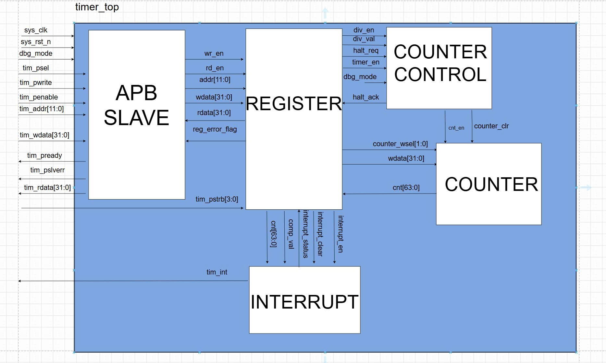

```text
+--------------------------------------------------------------------------------------------------------+
|                                              timer_top                                                 |
|                                                                                                        |
|      APB Bus Interface                                                                                 |
|   ======================> [ apb_slave ]                                                                |
|   - tim_psel                    |                                                                      |
|   - tim_penable                 |-- wr_en, rd_en, tim_pready, tim_pslverr                             |
|   - tim_pwrite                  v                                                                      |
|   - tim_paddr/pwdata/pstrb [ register ] <------------------------------+                               |
|   <-- tim_prdata                |                                       |                              |
|                                 |-- timer_en, div_en, div_val, halt_req |                              |
|                                 |-- wdata, counter_wsel[1:0]            |                              |
|                                 |-- comp_val[63:0], interrupt_en/clear  |                              |
|                                 |                                       |                              |
|                                 +-----------------------+               | cnt[63:0]                    |
|                                 |                       |               | interrupt_status             |
|                                 v                       v               | halt_ack                     |
|    dbg_mode -------------> [ counter_control ]     [ interrupt ] <------+                              |
|                                 |                       ^               |                              |
|                                 |-- cnt_en              |               |                              |
|                                 |-- counter_clr         |               |                              |
|                                 v                       |               |                              |
|                            [ counter ] -----------------+---------------+                              |
|                            (64-bit Core)                                                               |
|                                                                                                        |
|   Interrupt Output: tim_int <--------------------------------------------------------------------------+
+--------------------------------------------------------------------------------------------------------+
```

### Sub-block Responsibilities
1. **`apb_slave`**: Decodes APB protocol signals, inserts a 1-cycle wait state (`tim_pready`), produces clean single-cycle `wr_en` and `rd_en` pulses, and controls `tim_pslverr`.
2. **`register`**: Contains configuration registers (`TCR`, `TCMP0/1`, `TIER`, `THCSR`), performs byte-level masking with `tim_pstrb`, executes address decoding, decodes illegal accesses (`reg_error_flag`), and generates RW1C clear pulses.
3. **`counter_control`**: Houses the 8-bit dynamic prescaler (`divisor_counter`), calculates divider limits `(1 << div_val) - 1`, evaluates halt requests (`dbg_mode & halt_req`), and issues auto-clear pulses on `timer_en` falling edges.
4. **`counter`**: 64-bit synchronous counting engine with strict hardware priority: Synchronous Clear > 32-bit APB Write (`counter_wsel`) > Enable Increment (`cnt_en`).
5. **`interrupt`**: Houses the 64-bit hardware comparator (`cnt == comp_val`), latches interrupt pending status, enforces RW1C clear priority, and masks the output via `tim_int = interrupt_status & interrupt_en`.

---

## 5. Register Memory Map

### Register Summary Table

| Offset | Abbreviation | Register Name | Access Type | Reset Value | Description |
| :---: | :---: | :--- | :---: | :---: | :--- |
| `0x00` | **TCR** | Timer Control Register | R/W | `32'h0000_0100` | Controls enable, prescaler enable, and prescaler divisor. |
| `0x04` | **TDR0** | Timer Data Register 0 | R/W | `32'h0000_0000` | Lower 32 bits of the 64-bit counter. |
| `0x08` | **TDR1** | Timer Data Register 1 | R/W | `32'h0000_0000` | Upper 32 bits of the 64-bit counter. |
| `0x0C` | **TCMP0** | Timer Compare Register 0 | R/W | `32'hFFFF_FFFF` | Lower 32 bits of 64-bit interrupt compare threshold. |
| `0x10` | **TCMP1** | Timer Compare Register 1 | R/W | `32'hFFFF_FFFF` | Upper 32 bits of 64-bit interrupt compare threshold. |
| `0x14` | **TIER** | Timer Interrupt Enable Register | R/W | `32'h0000_0000` | Interrupt output enable mask bit. |
| `0x18` | **TISR** | Timer Interrupt Status Register | RW1C | `32'h0000_0000` | Interrupt pending flag (Write-1-to-Clear). |
| `0x1C` | **THCSR** | Timer Halt Control Status Register | R/W, RO | `32'h0000_0000` | Debug halt request and hardware halt acknowledge. |
| *Others* | **RESERVED** | Unmapped space | - | `32'h0000_0000` | Reads return 0; writes trigger `tim_pslverr`. |

---

### Detailed Register Bit-Level Field Definitions

#### 1. Timer Control Register (TCR) – `0x00`

```text
 31                                       12 11        8 7          2   1       0
+-------------------------------------------+-----------+------------+-------+-------+
|                 RESERVED                  |  div_val  |  RESERVED  |div_en |tim_en |
|                  (20-bit)                 |  (4-bit)  |   (6-bit)  |(1-bit)|(1-bit)|
+-------------------------------------------+-----------+------------+-------+-------+
```

| Bit | Name | Type | Reset Value | Description |
| :---: | :---: | :---: | :---: | :--- |
| `31:12` | RESERVED | RO | `20'h0` | Reserved. Always reads 0. |
| `11:8` | `div_val[3:0]` | RW | `4'b0001` | **Prescaler Division Factor Setting:**<br>• `4'b0000`: Counting speed is not divided (`2^0 = 1`)<br>• `4'b0001`: Divided by 2 (`2^1 = 2`, default)<br>• `4'b0010`: Divided by 4 (`2^2 = 4`)<br>• `4'b0011`: Divided by 8 (`2^3 = 8`)<br>• `4'b0100`: Divided by 16 (`2^4 = 16`)<br>• `4'b0101`: Divided by 32 (`2^5 = 32`)<br>• `4'b0110`: Divided by 64 (`2^6 = 64`)<br>• `4'b0111`: Divided by 128 (`2^7 = 128`)<br>• `4'b1000`: Divided by 256 (`2^8 = 256`)<br>• `Others`: **Prohibited settings**. Writing an invalid value triggers an APB error response (`tim_pslverr`) and `div_val` is not updated.<br>*(Note: Changing `div_val` while `timer_en == 1` is strictly prohibited and returns `tim_pslverr`).* |
| `7:2` | RESERVED | RO | `6'b0` | Reserved. Always reads 0. |
| `1` | `div_en` | RW | `1'b0` | **Counter Prescaler Enable:**<br>• `0`: Disabled. Counter increments directly on system clock.<br>• `1`: Enabled. Counter increments based on `div_val`.<br>*(Note: Changing `div_en` while `timer_en == 1` is strictly prohibited and returns `tim_pslverr`).* |
| `0` | `timer_en` | RW | `1'b0` | **Master Timer Enable:**<br>• `0`: Disabled. Counter is paused.<br>• `1`: Enabled. Counter starts incrementing.<br>*(Note: A High-to-Low transition (`1 -> 0`) triggers hardware auto-clear of `TDR0` and `TDR1`).* |

---

#### 2. Timer Data Register 0 (TDR0) – `0x04`

| Bit | Name | Type | Reset Value | Description |
| :---: | :---: | :---: | :---: | :--- |
| `31:0` | `TDR0[31:0]` | RW | `32'h0000_0000` | Lower 32 bits of the 64-bit counter (`cnt[31:0]`). Supports byte access via `tim_pstrb`. Cleared to 0 automatically when `timer_en` transitions from `1 -> 0`. |

#### 3. Timer Data Register 1 (TDR1) – `0x08`

| Bit | Name | Type | Reset Value | Description |
| :---: | :---: | :---: | :---: | :--- |
| `31:0` | `TDR1[31:0]` | RW | `32'h0000_0000` | Upper 32 bits of the 64-bit counter (`cnt[63:32]`). Supports byte access via `tim_pstrb`. Cleared to 0 automatically when `timer_en` transitions from `1 -> 0`. |

---

#### 4. Timer Compare Register 0 (TCMP0) – `0x0C`

| Bit | Name | Type | Reset Value | Description |
| :---: | :---: | :---: | :---: | :--- |
| `31:0` | `TCMP0[31:0]` | RW | `32'hFFFF_FFFF` | Lower 32 bits of the 64-bit compare threshold (`comp_val[31:0]`). Supports byte write strobe. An interrupt trigger occurs when `cnt[63:0] == comp_val[63:0]`. |

#### 5. Timer Compare Register 1 (TCMP1) – `0x10`

| Bit | Name | Type | Reset Value | Description |
| :---: | :---: | :---: | :---: | :--- |
| `31:0` | `TCMP1[31:0]` | RW | `32'hFFFF_FFFF` | Upper 32 bits of the 64-bit compare threshold (`comp_val[63:32]`). Supports byte write strobe. |

---

#### 6. Timer Interrupt Enable Register (TIER) – `0x14`

| Bit | Name | Type | Reset Value | Description |
| :---: | :---: | :---: | :---: | :--- |
| `31:1` | RESERVED | RO | `31'h0` | Reserved. Always reads 0. |
| `0` | `int_en` | RW | `1'b0` | **Timer Interrupt Enable:**<br>• `0`: Disabled. `tim_int` output is forced LOW.<br>• `1`: Enabled. Allows pending interrupt to drive `tim_int` HIGH.<br>*(Clearing `int_en` masks `tim_int` but does not alter the pending flag `TISR.int_st`).* |

---

#### 7. Timer Interrupt Status Register (TISR) – `0x18`

| Bit | Name | Type | Reset Value | Description |
| :---: | :---: | :---: | :---: | :--- |
| `31:1` | RESERVED | RO | `31'h0` | Reserved. Always reads 0. |
| `0` | `int_st` | RW1C | `1'b0` | **Timer Interrupt Status Pending Bit:**<br>• `0`: Interrupt condition has not occurred.<br>• `1`: Interrupt condition occurred (`cnt == comp_val`).<br>• **Clear rule (RW1C):** Writing `1` clears this bit to `0`. Writing `0` has no effect. The hardware clear command holds highest priority over simultaneous trigger events. Counter continues counting after trigger. |

---

#### 8. Timer Halt Control Status Register (THCSR) – `0x1C`

| Bit | Name | Type | Reset Value | Description |
| :---: | :---: | :---: | :---: | :--- |
| `31:2` | RESERVED | RO | `30'h0` | Reserved. Always reads 0. |
| `1` | `halt_ack` | RO | `1'b0` | **Timer Halt Acknowledge Status:**<br>• `0`: Timer is actively running (not halted).<br>• `1`: Timer counting is safely halted.<br>*(Asserted only when both `dbg_mode == 1` and `halt_req == 1`).* |
| `0` | `halt_req` | RW | `1'b0` | **Timer Halt Request:**<br>• `0`: Normal operation.<br>• `1`: Software requests the timer counter to pause. |

---

## 6. Functional Description & Sub-block Logic Design

### 6.1. APB Slave Block (`rtl/apb_slave.v`)

The APB Slave block provides a standard AMBA 3 APB interface between the system bus and internal registers.

#### Timing Waveforms
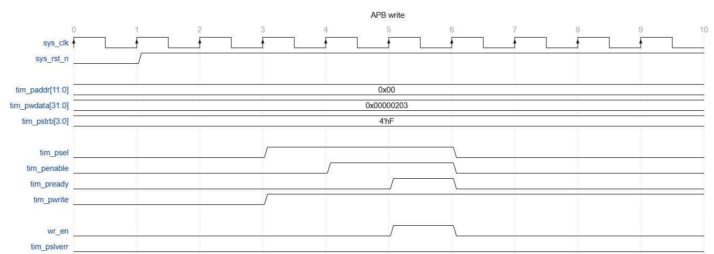
*Figure: APB Slave Write waveform with 1-cycle wait state.*

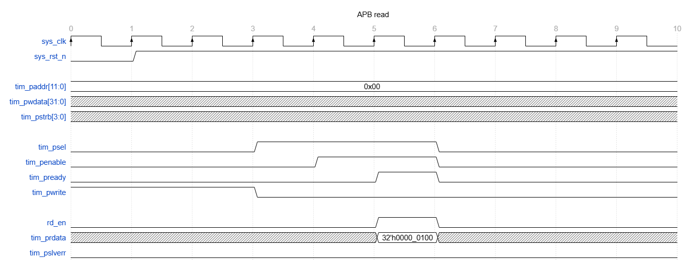
*Figure: APB Slave Read waveform with 1-cycle wait state.*

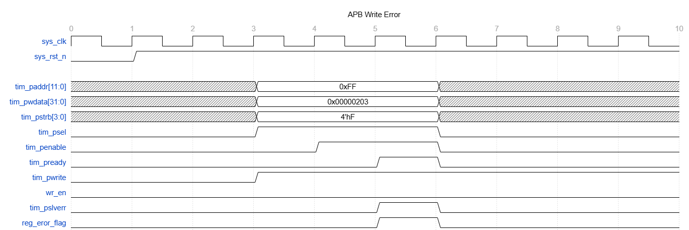
*Figure: APB Slave Error Response timing waveform.*

#### Logic Diagram
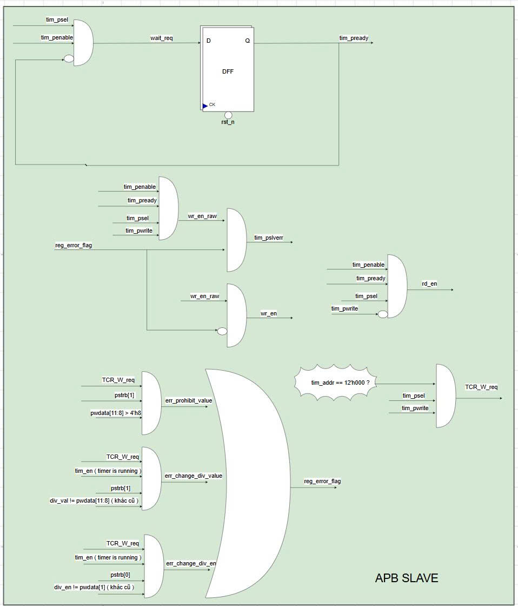

```text
                  +----------------------------------------------+
  tim_psel ------>|                                              |
  tim_penable --->|              1-Cycle Wait State             |-----> tim_pready
                  |               (D-FF Generator)               |
                  +----------------------------------------------+
                                         |
  tim_pwrite ----------------------------+-------> wr_en_raw
                                         |              |
  reg_error_flag ------------------------+              v
                                         |          [ AND Gate ] -----> wr_en (to Register)
                                         v              ^
                                    [ AND Gate ]        | (~reg_error_flag)
                                         |
                                         v
                                    tim_pslverr
```

- **1-Cycle Wait State Generation:** A sequential D-Flip Flop delays `tim_pready` by exactly one clock cycle after entering the access phase (`tim_psel & tim_penable`). This guarantees single-wait-state bus transfers.
- **Enable Pulse Generation:**
  - `wr_en = tim_pready & tim_penable & tim_psel & tim_pwrite & ~reg_error_flag`
  - `rd_en = tim_pready & tim_penable & tim_psel & ~tim_pwrite`
- **Error Response:** When the register block reports `reg_error_flag = 1`, `tim_pslverr` is driven HIGH simultaneously with `tim_pready`, and `wr_en` is inhibited to prevent corrupted register states.

---

### 6.2. Register Block (`rtl/register.v`)

The Register block acts as the central configuration and status control hub.

#### Sơ đồ giải mã địa chỉ & Điều khiển ghi (Address Decoder)
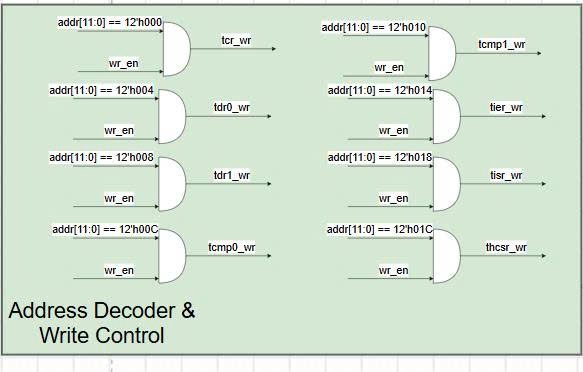

#### Sơ đồ logic thanh ghi TCR (Timer Control Register)
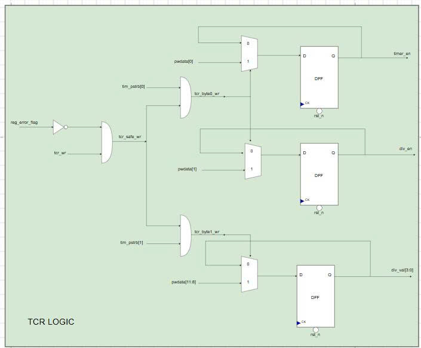

#### Sơ đồ logic thanh ghi TDR0 và TDR1 (Data Registers)
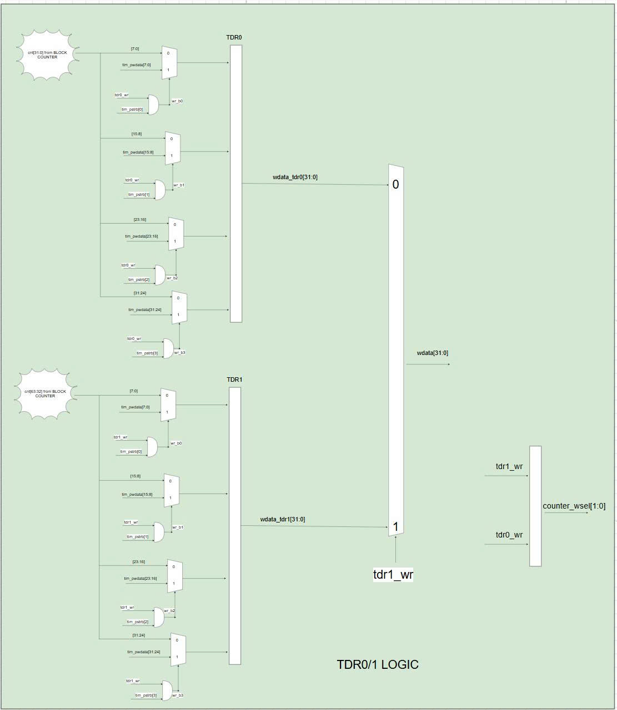

#### Sơ đồ logic thanh ghi TCMP0 và TCMP1 (Compare Registers)
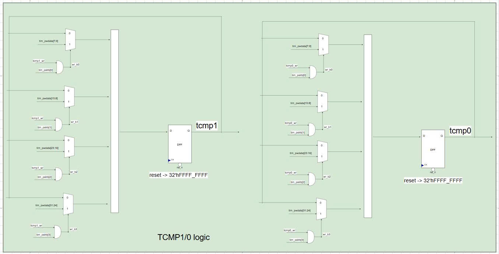

#### Sơ đồ logic thanh ghi TIER & THCSR
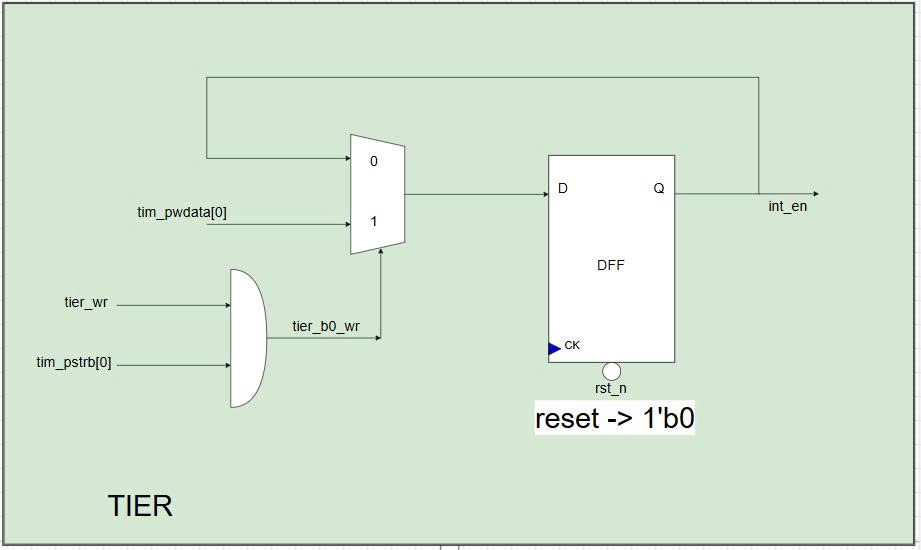
*Figure: TIER (Interrupt Enable) logic diagram.*

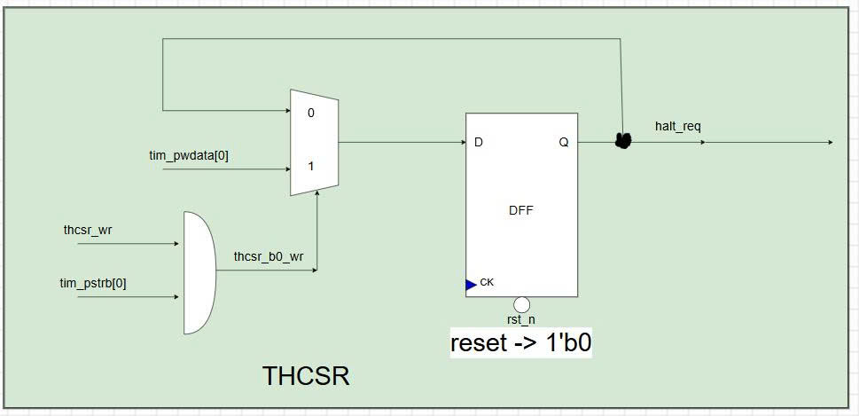
*Figure: THCSR (Halt Control Status) logic diagram.*

#### Sơ đồ bộ dồn kênh đọc (Read Multiplexer)
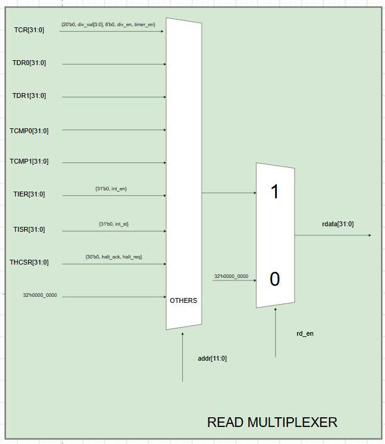

1. **Address Decoding:** Evaluates `addr[11:0]` against predefined offsets to generate active-high write strobes (`tcr_wr`, `tdr0_wr`, `tdr1_wr`, `tcmp0_wr`, `tcmp1_wr`, `tier_wr`, `tisr_wr`, `thcsr_wr`).
2. **Hardware Protection (`reg_error_flag`):** Traps prohibited configurations:
   - Setting `div_val > 4'd8`.
   - Modifying `div_val` while `timer_en == 1`.
   - Modifying `div_en` while `timer_en == 1`.
3. **Byte-Level Strobe Masking:** Four independent multiplexers per 32-bit register combine incoming `pwdata` with live feedback register bits according to `tim_pstrb[3:0]`.
4. **RW1C Clear Pulse Logic:** Combinational detection of `tisr_wr & tim_pstrb[0] & tim_pwdata[0]` issues a single-cycle `interrupt_clear` pulse.
5. **Power & Leakage Gating:** Read data multiplexer output is gated by `rd_en`; when `rd_en == 0`, `rdata` is forced to `32'h0000_0000` to prevent bus toggling and dynamic power dissipation.

---

### 6.3. Counter Control Block (`rtl/counter_control.v`)

The Counter Control block serves as the operational brain and timing prescaler for the 64-bit counter:

#### Timing Waveforms (Frequency Division & Debug Halt)
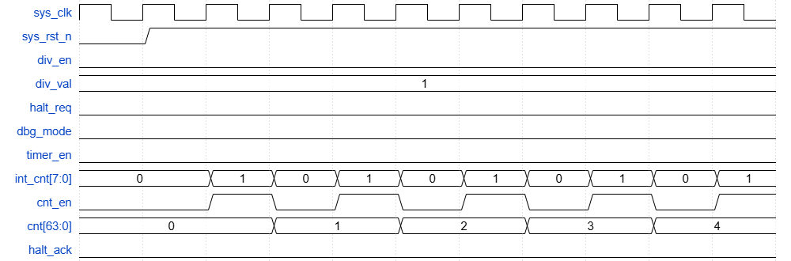
*Figure: Counter Control timing with div_val = 1 (Divide by 2).*

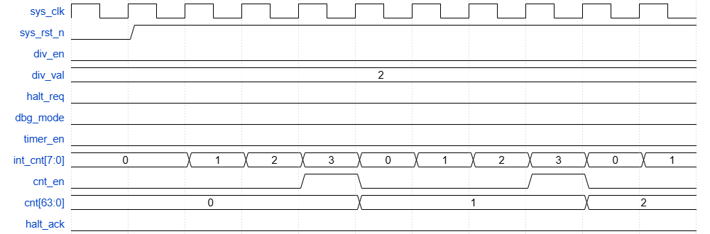
*Figure: Counter Control timing with div_val = 2 (Divide by 4).*

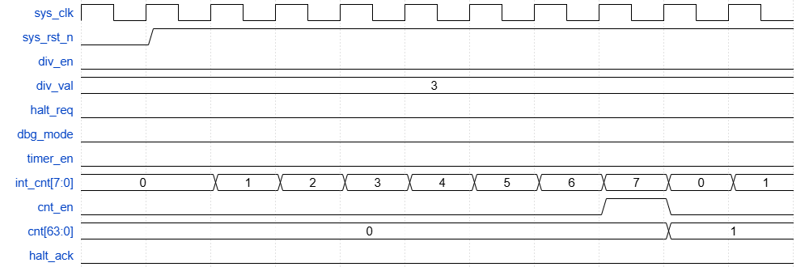
*Figure: Counter Control timing with div_val = 3 (Divide by 8).*

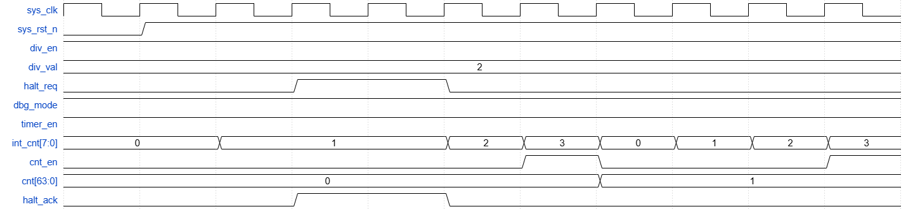
*Figure: Halt Request Accepted (dbg_mode = 1).*

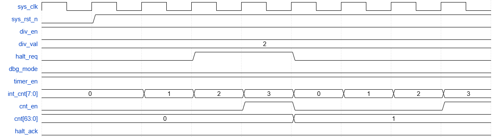
*Figure: Halt Request Denied (dbg_mode = 0).*

#### Logic Diagram
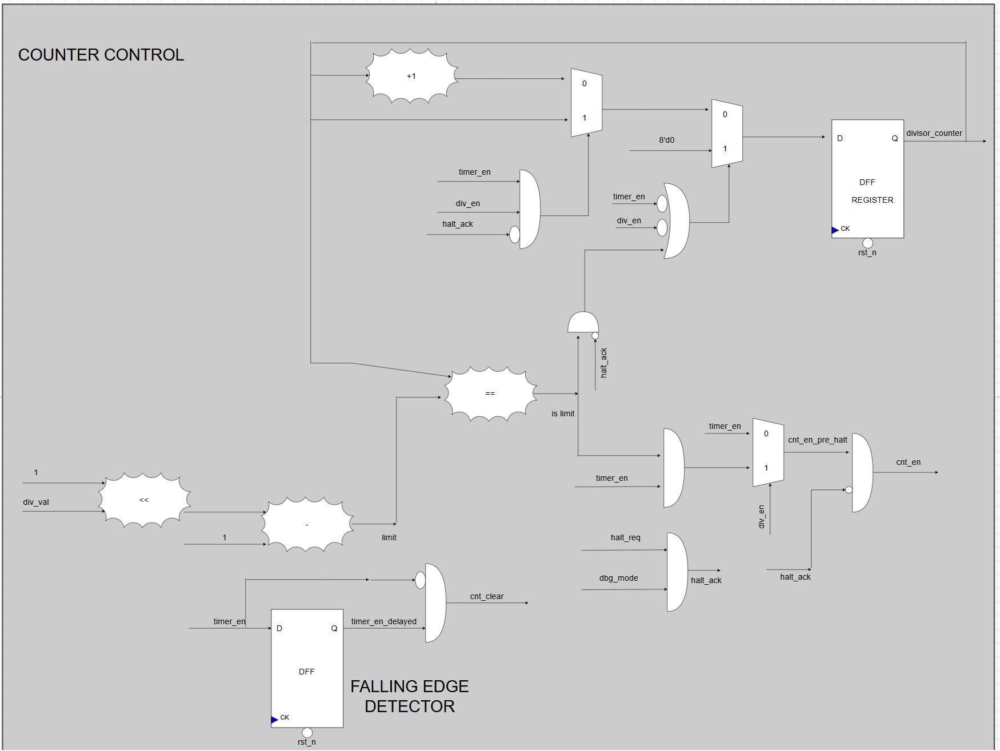

```text
                      +---------------------------------------+
  halt_req ---------->|             halt_ack Logic            |-----> halt_ack
  dbg_mode ---------->|        (halt_ack = halt_req & dbg)    |
                      +---------------------------------------+

  div_val[3:0] ------> limit = (8'd1 << div_val) - 8'd1
  
                             +-----------------------+
                             | 8-bit Prescaler DFF   |
  divisor_counter ---------->| (divisor_counter + 1) |-----> is_limit = (divisor_counter == limit)
                             +-----------------------+
                                         |
                                         v
  timer_en, div_en ----------------> [ Mode MUX ] ---------> cnt_en_pre_halt
                                                                 |
  ~halt_ack ----------------------------------------------------[ AND ] -----> cnt_en (to Counter)

  timer_en ---------> [ DFF Delay ] ----> timer_en_dly
                           |
                           v
              counter_clr = ~timer_en & timer_en_dly (Auto-Clear Pulse)
```

1. **Halt Acknowledge Logic:** Combinational zero-latency gate: `halt_ack = halt_req & dbg_mode`.
2. **Dynamic Limit Calculation:** Computes the prescaler threshold dynamically:
   ```verilog
   limit = (8'd1 << div_val) - 8'd1;
   ```
   - `div_val = 1` → limit = 1 (Divide by 2)
   - `div_val = 2` → limit = 3 (Divide by 4)
   - `div_val = 3` → limit = 7 (Divide by 8)
   - `div_val = 8` → limit = 255 (Divide by 256)
3. **Prescaler Cascade Priority:**
   - **Clear:** `(~timer_en) | (~div_en) | (is_limit & ~halt_ack)` → resets `divisor_counter` to 0.
   - **Increment:** `timer_en & div_en & ~halt_ack` → `divisor_counter + 1`.
   - **Hold:** Preserves `divisor_counter` when `halt_ack == 1`.
4. **Auto-Clear Edge Detector:** Registers `timer_en` into `timer_en_dly`. When `~timer_en & timer_en_dly` evaluates to 1, a single-cycle synchronous pulse `counter_clr` is dispatched to reset the 64-bit counter.

---

### 6.4. Counter Block (`rtl/counter.v`)

The Counter block implements the 64-bit timing engine with a strict 3-tier multiplexer priority cascade:

#### Timing Waveform (64-bit Counter Sequential Write)
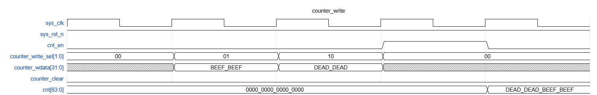
*Figure: Two-phase 32-bit APB write updating the 64-bit counter.*

#### Logic Diagram
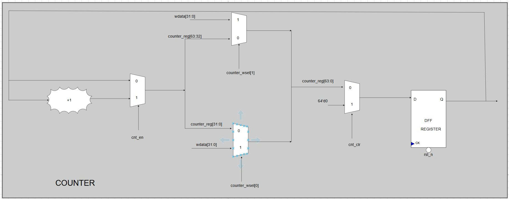

```text
                  +-------------------------------------------------------------+
                  |                  64-bit Counter Architecture                |
                  +-------------------------------------------------------------+

  [Lowest Priority]
  cnt[63:0] + 1 ---------\
                          MUX (cnt_en) --------------> next_cnt_val[63:0]
  cnt[63:0] -------------/                                   |
                                                             v
  [Medium Priority]
  wdata[31:0] -----------\                               Split-Word MUX:
                          MUX (counter_wsel[1:0]) --->   [63:32] updated if wsel[1]
  next_cnt_val ----------/                              [31:0]  updated if wsel[0]
                                                             |
                                                             v
                                                        muxed_data[63:0]
                                                             |
  [Highest Priority]                                         v
  64'd0 -----------------\
                          MUX (counter_clr) ---------> dff_d_input[63:0]
  muxed_data ------------/                                   |
                                                             v
                                                  +--------------------+
                                                  | 64-bit D-FF (cnt)  |
                                                  | Clock: sys_clk     |
                                                  | Reset: sys_rst_n   |
                                                  +--------------------+
```

- **Priority 1 (Highest) – Synchronous Clear (`counter_clr`):** Overrides all writes and counting operations to force `dff_d_input = 64'd0`.
- **Priority 2 (Medium) – 32-bit APB Write (`counter_wsel[1:0]`):** Enables independent updates to lower (`wsel[0]`) or upper (`wsel[1]`) 32 bits without corrupting the unaddressed half.
- **Priority 3 (Lowest) – Sequential Increment (`cnt_en`):** Increments `cnt + 1` whenever enabled; holds state when idle.

---

### 6.5. Interrupt Block (`rtl/interrupt.v`)

The Interrupt block manages event detection, status holding, and CPU notification:

#### Timing Waveform (Threshold Trigger & RW1C Clear)
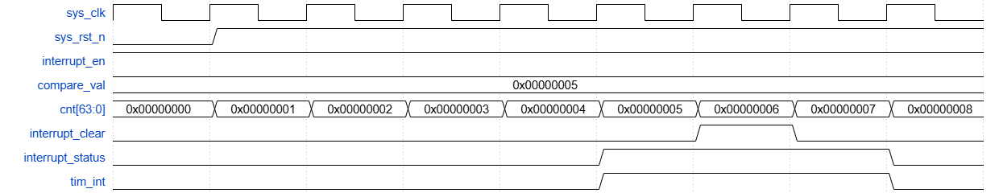
*Figure: Interrupt assertion upon counter match and software RW1C clearance.*

#### Logic Diagram
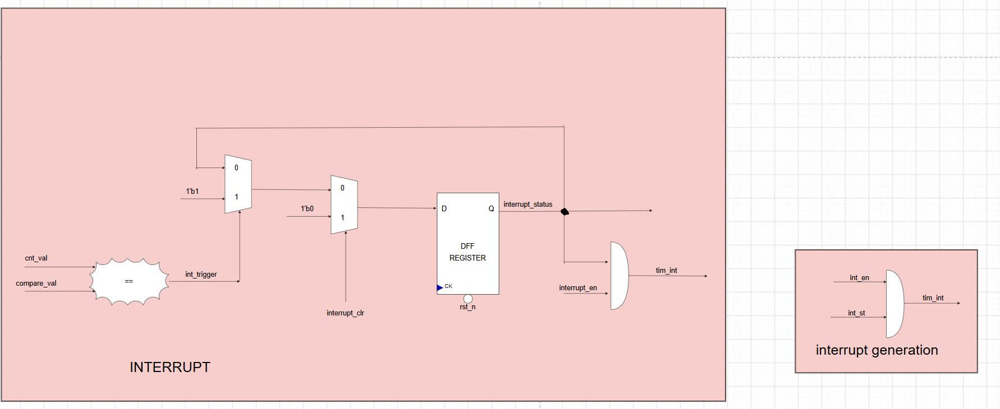

```text
  cnt[63:0] --------\
                     [ 64-bit Comparator (==) ] -----> int_trigger
  comp_val[63:0] ---/                                     |
                                                          v
                                                  +---------------+
  int_status_q (Loopback) ----------------------->| Set/Hold MUX  |
                                                  +---------------+
                                                          |
                                                          v
  1'b0 (Clear State) ---------------------------->| Clear MUX     |<----- interrupt_clear (TISR RW1C)
                                                  | (Highest Pri) |
                                                  +---------------+
                                                          |
                                                          v
                                                  [ DFF: int_status_q ]
                                                          |
                                      +-------------------+-------------------+
                                      |                                       |
                                      v                                       v
                               interrupt_status                          [ AND Gate ]
                              (to TISR bit 0)                                 ^
                                                                              |
                                                      interrupt_en -----------+
                                                                              |
                                                                              v
                                                                           tim_int (to CPU)
```

- **Hardware Comparator:** Evaluates `int_trigger = (cnt[63:0] == comp_val[63:0])`.
- **Set & Retain (Loopback):** Once triggered, `int_status_q` remains latched at `1'b1` even as `cnt` continues to increment past `comp_val`.
- **Clear Priority:** `interrupt_clear` unconditionally resets the latch to `1'b0`, holding strict priority over simultaneous triggers.
- **Output Masking:** `tim_int = interrupt_status & interrupt_en`.

---

## 7. Verification Plan & Test Strategy

Verification is implemented in `code/tb/test_bench.v` with dedicated modular testcases under `code/testcases/`.

### Testcases Checklist Summary

| ID | Testcase Name | Target Coverage / Verified Features | Result |
| :---: | :--- | :--- | :---: |
| 1 | `apb_error_handling` | Prohibited `div_val > 8`, modifying `div_val`/`div_en` while running, unmapped addresses | **PASSED** |
| 2 | `apb_wait_state` | 1-cycle wait state verification on APB read/write via `tim_pready` | **PASSED** |
| 3 | `apb_protocol_chk` | Protocol setup/access phase timing, back-to-back APB transfers | **PASSED** |
| 4 | `reg_init_chk` | Power-on default reset values for all registers (`TCR`, `TDR`, `TCMP`, `TIER`, `TISR`, `THCSR`) | **PASSED** |
| 5 | `reg_reserved_chk` | Accessing read-only reserved bits to verify they remain 0 | **PASSED** |
| 6 | `reg_1hot_chk` | Walking-1 / one-hot bit pattern checks across writeable registers | **PASSED** |
| 7 | `reg_byte_access` | Byte-level access verification with individual `tim_pstrb[3:0]` strobes on `TDR` and `TCMP` | **PASSED** |
| 8 | `reg_rw_chk` | Full 32-bit data read/write retention and write data integrity | **PASSED** |
| 9 | `cnt_halt_chk` | Debug halt acceptance (`dbg_mode=1`) vs rejection (`dbg_mode=0`), counter freeze and resume | **PASSED** |
| 10 | `cnt_ctrl_chk` | Prescaler divider ratios (divide by 1, 2, 4, 8 ... 256) and `timer_en` auto-clear (`1 -> 0`) | **PASSED** |
| 11 | `interrupt_chk` | Compare threshold match, interrupt pending latch, mask enable (`TIER`), and RW1C clear (`TISR`) | **PASSED** |
| 12 | `counter_chk` | 32-bit rollover, 64-bit full-scale overflow, counter manual reload via `TDR0`/`TDR1` | **PASSED** |

---

## 8. Regression Verification Results

All 12 testcases were executed under QuestaSim/ModelSim and Icarus Verilog regression suites.

```text
+---------------------+-----------------------+--------+
| PAT_NAME            | RUN_DATE              | RESULT |
+---------------------+-----------------------+--------+
| apb_error_handling  | 20:59:16 Sep 16 2026  | PASSED |
| apb_wait_state      | 20:59:19 Sep 16 2026  | PASSED |
| apb_protocol_chk    | 20:59:21 Sep 16 2026  | PASSED |
| reg_init_chk        | 20:59:23 Sep 16 2026  | PASSED |
| reg_reserved_chk    | 20:59:25 Sep 16 2026  | PASSED |
| reg_1hot_chk        | 20:59:28 Sep 16 2026  | PASSED |
| reg_byte_access     | 20:59:30 Sep 16 2026  | PASSED |
| reg_rw_chk          | 20:59:32 Sep 16 2026  | PASSED |
| cnt_halt_chk        | 20:59:34 Sep 16 2026  | PASSED |
| cnt_ctrl_chk        | 20:59:37 Sep 16 2026  | PASSED |
| interrupt_chk       | 20:59:39 Sep 16 2026  | PASSED |
| counter_chk         | 20:59:42 Sep 16 2026  | PASSED |
+---------------------+-----------------------+--------+
```

**Overall Regression Status:** **12/12 Tests PASSED (100% Success Rate)**.

---

## 9. Code Coverage & Waiver Analysis

### 9.1. Coverage Holes Identification (Raw Analysis)
Initial raw coverage recorded 95.23% Expression Coverage on top-level `dut` due to unhit bins in `rtl/apb_slave.v`:
- **Line 50 (`wr_en_raw`):** `tim_pready & tim_penable & tim_psel & tim_pwrite`
- **Line 55 (`rd_en`):** `tim_pready & tim_penable & tim_psel & (~tim_pwrite)`

### 9.2. Coverage Waivers & Engineering Justification
1. **Illegal Protocol State (`tim_psel == 0` when `tim_penable == 1`):**
   - *Justification:* Under ARM AMBA APB 3 specification, `PENABLE` indicates the Access Phase and can only assert following `PSEL`. A bus transaction where `PENABLE = 1` while `PSEL = 0` violates the standard protocol. The verified master never generates illegal bus violations.
2. **Architecturally Unreachable State (`tim_penable == 0` when `tim_psel == 1 & tim_pready == 1`):**
   - *Justification:* In this specific custom APB Slave RTL, `tim_pready` is intentionally gated and only evaluated during the Access Phase (`PENABLE = 1`). Observing `PREADY = 1` while `PENABLE = 0` is physically impossible in this hardware architecture.

### 9.3. Exclusion Script (`exclude.do`)
```tcl
coverage exclude -src ../rtl/apb_slave.v -code e -line 50 -comment {illegal AMBA APB rules}
coverage exclude -src ../rtl/apb_slave.v -code e -line 55 -comment {illegal AMBA APB rules}
```

### 9.4. Final Coverage Summary (100% Achieved)

```text
================================================================================
Coverage Report Summary Data by Instance (Post-Exclusion)
================================================================================
Instance: /test_bench/dut/u_apb_slave (apb_slave)
  Branches     :  2 / 2    (100.00%)
  Expressions  :  7 / 7    (100.00%)
  Statements   :  8 / 8    (100.00%)
  Toggles      : 330 / 330 (100.00%)

Instance: /test_bench/dut/u_register (register)
  Branches     :  59 / 59   (100.00%)
  Conditions   :  32 / 32   (100.00%)
  Expressions  :  42 / 42   (100.00%)
  Statements   :  65 / 65   (100.00%)
  Toggles      : 1014 / 1014 (100.00%)

Instance: /test_bench/dut/u_counter_control (counter_control)
  Branches     : 10 / 10   (100.00%)
  Expressions  : 20 / 20   (100.00%)
  Statements   : 16 / 16   (100.00%)
  Toggles      : 88 / 88   (100.00%)

Instance: /test_bench/dut/u_counter (counter)
  Branches     : 10 / 10   (100.00%)
  Statements   :  7 / 7    (100.00%)
  Toggles      : 844 / 844 (100.00%)

Instance: /test_bench/dut/u_interrupt (interrupt)
  Branches     :  6 / 6    (100.00%)
  Expressions  :  7 / 7    (100.00%)
  Statements   :  7 / 7    (100.00%)
  Toggles      : 276 / 276 (100.00%)

Instance: /test_bench/dut (timer_top)
  Toggles      : 686 / 686 (100.00%)
================================================================================
FINAL VERIFICATION STATEMENT:
Total Design Coverage: 100.00% across Statements, Branches, Conditions, Expressions, and Toggles.
================================================================================
```

---

## 10. Repository Directory Structure

```text
code/
├── docs/                       # Project Documentation & Architecture Diagrams
│   └── images/                 # Sơ đồ nguyên lý Draw.io & Waveforms
│       ├── timer_top_block_diagram.jpg
│       ├── apb_slave_logic.jpg
│       ├── address_decoder_logic.jpg
│       ├── tcr_logic.jpg
│       ├── tdr_logic.jpg
│       ├── tcmp_logic.jpg
│       ├── tier_logic.jpg
│       ├── thcsr_logic.jpg
│       ├── read_mux_logic.jpg
│       ├── counter_control_logic.jpg
│       ├── counter_logic.jpg
│       ├── interrupt_logic.jpg
│       ├── apb_write_waveform.png
│       ├── apb_read_waveform.png
│       ├── apb_error_waveform.png
│       ├── counter_control_div1_waveform.png
│       ├── counter_control_div2_waveform.png
│       ├── counter_control_div3_waveform.png
│       ├── counter_control_halt_ack_waveform.png
│       ├── counter_control_halt_denied_waveform.png
│       ├── counter_write_waveform.png
│       └── interrupt_waveform.png
├── rtl/                        # Synthesizable RTL Verilog source files
│   ├── timer_top.v             # Top-level integration module
│   ├── apb_slave.v             # AMBA 3 APB Slave & wait-state interface
│   ├── register.v              # Memory-mapped register file & decoder
│   ├── counter_control.v       # Prescaler clock divider & halt control
│   ├── counter.v               # 64-bit prioritized synchronous counter
│   └── interrupt.v             # 64-bit comparator & RW1C interrupt status
├── tb/                         # Verification Testbench
│   └── test_bench.v            # APB Master BFMs, tasks, and golden model
├── testcases/                  # Modular Verification Testcases
│   ├── apb_error_handling.v    # PSLVERR and prohibited register write checks
│   ├── apb_protocol_chk.v      # APB protocol setup & access phase timing
│   ├── apb_wait_state.v        # 1-cycle wait-state assertion checks
│   ├── cnt_ctrl_chk.v          # Prescaler dividers (div by 1..256) & auto-clear
│   ├── cnt_halt_chk.v          # Debug mode halt request & acknowledge
│   ├── counter_chk.v           # 32-bit rollover, 64-bit overflow, counter reload
│   ├── interrupt_chk.v         # Threshold trigger, enable mask & RW1C clear
│   ├── reg_1hot_chk.v          # Walking-1 / one-hot register bit tests
│   ├── reg_byte_access.v       # Byte strobe (tim_pstrb) write checks
│   ├── reg_init_chk.v          # Power-on default reset values
│   ├── reg_reserved_chk.v      # Reserved bit read-only protection checks
│   └── reg_rw_chk.v            # 32-bit read/write data retention
└── sim/                        # EDA Simulation Scripts
    ├── compile.f               # Filelist for compilation
    ├── rtl.f                   # RTL filelist
    ├── tb.f                    # TB filelist
    ├── pat.list                # Testcase regression list
    ├── run.csh                 # Shell execution script
    ├── report.csh              # Regression report generator
    └── Makefile                # QuestaSim / ModelSim Makefile
```

---

## 11. How to Run Simulation

### Environment 1: QuestaSim / ModelSim (Industry Standard)

Run a single testcase:
```bash
cd sim
make all TESTNAME=counter_chk
```

Run complete regression suite with coverage:
```bash
cd sim
./run.csh
./report.csh
```

View waveforms in QuestaSim:
```bash
vsim -view vsim.wlf
```

### Environment 2: Icarus Verilog (Open-Source Free Simulator)

Run any specific testcase (e.g., `counter_chk`):
```bash
cd sim
cp ../testcases/counter_chk.v run_test.v
iverilog -g2012 -o sim_test.vvp -I. -f compile.f
vvp sim_test.vvp
```

View waveforms with GTKWave:
```bash
gtkwave dump.vcd
```
